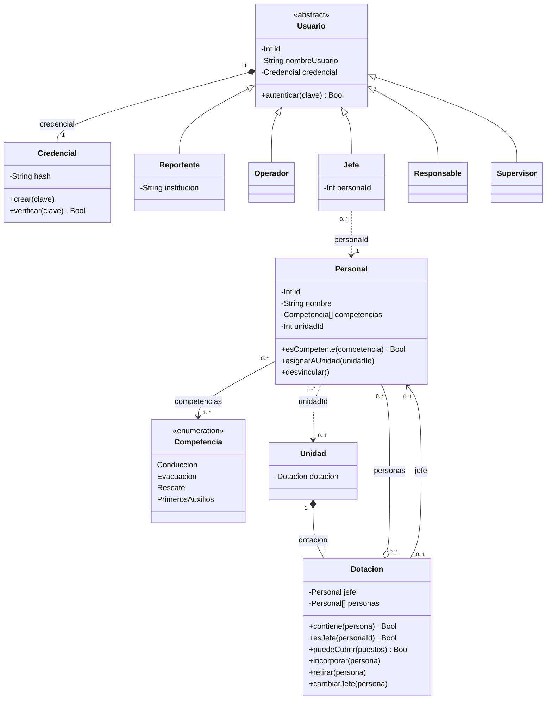
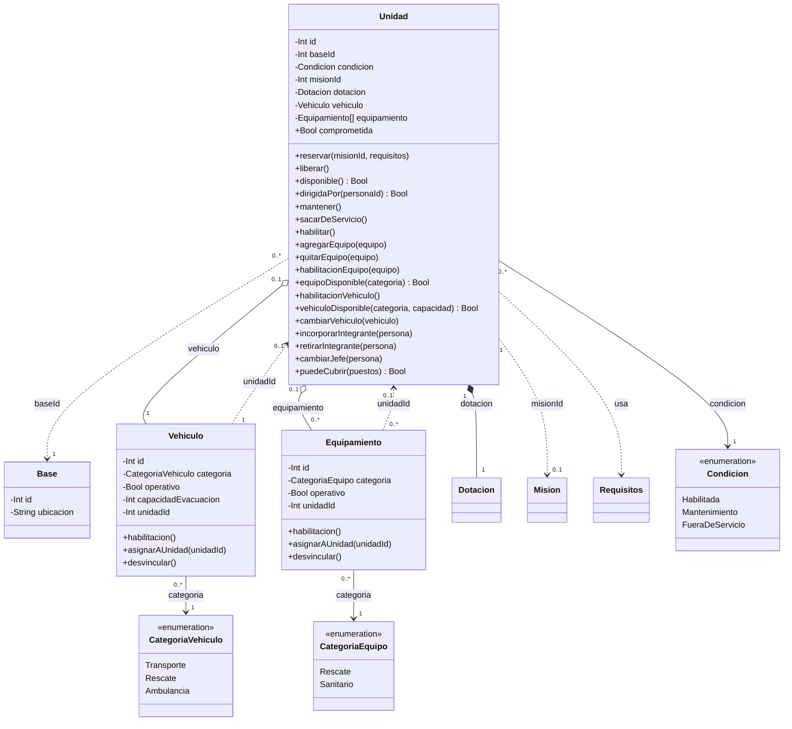
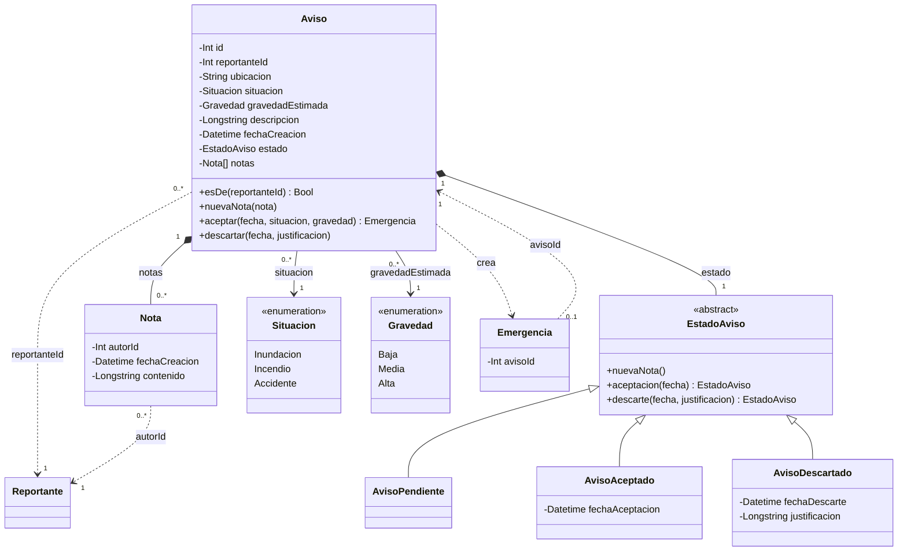
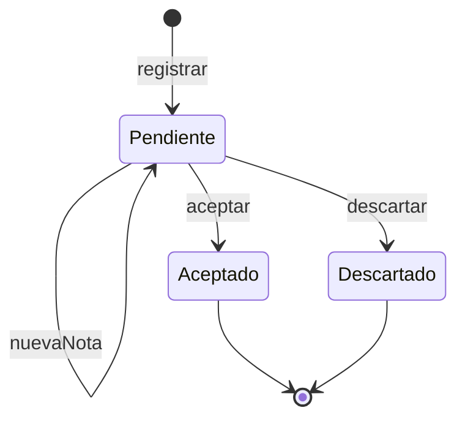
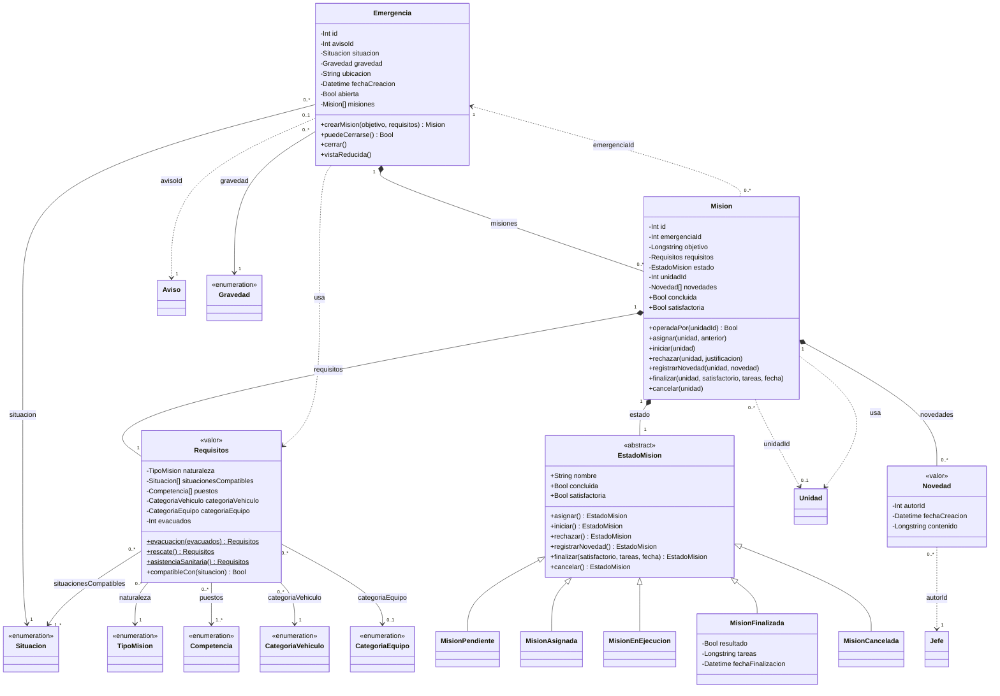
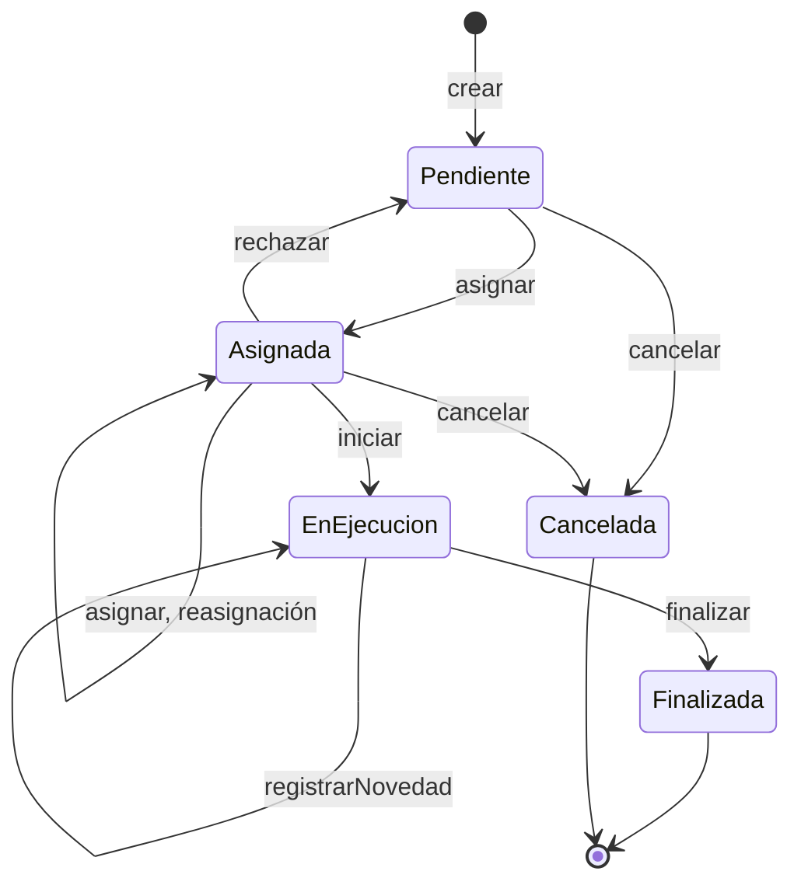
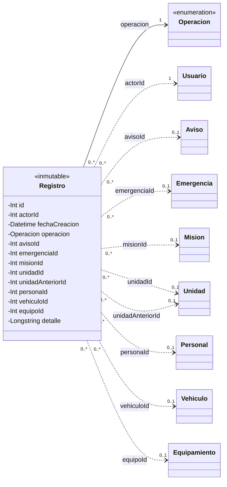

```mermaid
classDiagram
    direction LR

    class Situacion {
        <<enumeration>>
        Inundacion
        Incendio
        Accidente
    }
    class Gravedad {
        <<enumeration>>
        Baja
        Media
        Alta
    }
    class Competencia {
        <<enumeration>>
        Conduccion
        Evacuacion
        Rescate
        PrimerosAuxilios
    }
    class CategoriaEquipo {
        <<enumeration>>
        Rescate
        Sanitario
    }
    class CategoriaVehiculo {
        <<enumeration>>
        Transporte
        Rescate
        Ambulancia
    }
    class Condicion {
        <<enumeration>>
        Habilitada
        Mantenimiento
        FueraDeServicio
    }
    class TipoMision {
        <<enumeration>>
        Evacuacion
        Rescate
        AsistenciaSanitaria
    }
    class Operacion {
        <<enumeration>>
        CrearAviso
        AgregarNota
        AceptarAviso
        DescartarAviso
        CrearEmergencia
        CerrarEmergencia
        CrearMision
        AsignarMision
        ReasignarMision
        RechazarMision
        IniciarMision
        RegistrarNovedad
        CancelarMision
        FinalizarMision
        IncorporarIntegrante
        RetirarIntegrante
        CambiarJefe
        CambiarVehiculo
        AgregarEquipo
        QuitarEquipo
        HabilitacionEquipo
        HabilitacionVehiculo
        MantenerUnidad
        SacarDeServicioUnidad
        HabilitarUnidad
    }
```

# Sistema en General

- **Nombre**: Centro Regional de Coordinación de Emergencias (CRCE)
- **Recibe**: Avisos.
	- Inundaciones
	- Incendios
	- Accidentes viales
- **Tareas de los Operadores**:
	- Evaluar situaciones avisadas
	- Registrar emergencias a intervenir
	- Organizar intervenciones
- **Jerarquía**:
	- CRCE
		- Bases Operativas
			- Unidades de Respuesta
				- Personal
					- Jefe
- **Workflow**:
	1. Se reporta una Situación de Emergencia
	2. El Aviso es Aceptado
	3. Se genera en el sistema una Emergencia
	4. Se organizan Misiones hasta cerrar la emergencia
- **Requisitos Básicos**:
	- [ ] Coordinar operaciones
	- [ ] Administrar recursos disponibles
	- [ ] Registrar lo hecho
	- [ ] Administrar información sobre evolución de las emergencias.

---
# Participantes

- **Reportantes Institucionales**: Quienes reportan las situaciones mediante avisos que recibe el sistema.
- **Operadores de Coordinación**: Quienes revisan los avisos, generan emergencias y coordinan las misiones.
- **Jefes de Unidad**: Quienes dirigen las intervenciones, iniciando o rechazando misiones además de registrar los avances y resultados de las mismas.
- **Responsables de Recursos**: Administran la composición y condición de las unidades de respuesta, además de otros recursos del CRCE.
- **Supervisores Regionales**: Administran en general al CRCE, pudiendo consultar toda la información y cerrar emergencias que hayan concluido.

---
# Clases Propuestas

### Enumeraciones

- [ ] Enumeración `Situacion`
	- `Inundacion`
	- `Incendio`
	- `Accidente`

- [ ] Enumeración `Gravedad`
	- `Baja = 1`
	- `Media = 2`
	- `Alta = 3`

- [ ] Enumeración `Competencia`
	- `Conduccion`
	- `Evacuacion`
	- `Rescate`
	- `PrimerosAuxilios`

- [ ] Enumeración `CategoriaEquipo`
	- `Rescate`
	- `Sanitario`

- [ ] Enumeración `CategoriaVehiculo`
	- `Transporte`
	- `Rescate`
	- `Ambulancia`

- [ ] Enumeración `Condicion`
	- `Habilitada`
	- `Mantenimiento`
	- `FueraDeServicio`

- [ ] Enumeración `TipoMision`
	- `Evacuacion`
	- `Rescate`
	- `AsistenciaSanitaria`

- [ ] Enumeración `Operacion`
	- `CrearAviso`
	- `AgregarNota`
	- `AceptarAviso`
	- `DescartarAviso`
	- `CrearEmergencia`
	- `CerrarEmergencia`
	- `CrearMision`
	- `AsignarMision`
	- `ReasignarMision`
	- `RechazarMision`
	- `IniciarMision`
	- `RegistrarNovedad`
	- `CancelarMision`
	- `FinalizarMision`
	- `IncorporarIntegrante`
	- `RetirarIntegrante`
	- `CambiarJefe`
	- `CambiarVehiculo`
	- `AgregarEquipo`
	- `QuitarEquipo`
	- `HabilitacionEquipo`
	- `HabilitacionVehiculo`
	- `MantenerUnidad`
	- `SacarDeServicioUnidad`
	- `HabilitarUnidad`

##### Diagrama de Clases

##### Tarjetas CRC

|     Enumeración     | Responsabilidades                                                  |            Colaboradores             |
| :-----------------: | ------------------------------------------------------------------ | :----------------------------------: |
|     `Situacion`     | Definir los tipos de situación de emergencia reconocidos.          | `Aviso`, `Emergencia`, `Requisitos`  |
|     `Gravedad`      | Definir los niveles de gravedad y su orden de prioridad.           |         `Aviso`, `Emergencia`        |
|    `Competencia`    | Definir las competencias del personal y los puestos de una misión. | `Personal`, `Dotacion`, `Requisitos` |
|  `CategoriaEquipo`  | Definir las categorías de equipamiento especializado.              | `Equipamiento`, `Unidad`, `Requisitos` |
| `CategoriaVehiculo` | Definir las categorías de vehículo.                                |   `Vehiculo`, `Unidad`, `Requisitos` |
|     `Condicion`     | Definir la condición de servicio de una unidad.                    |               `Unidad`               |
|    `TipoMision`     | Definir los tipos de misión que reconoce el CRCE.                  |            `Requisitos`              |
|     `Operacion`     | Definir las operaciones que quedan registradas en el historial.    |             `Registro`               |

### Usuarios y Personal

- [ ] Clase `Usuario(ABC)`
	- **Atributos**:
		- **`(Int) id`**: Identificador único del usuario.
		- **`(String) nombreUsuario`**: Nombre que identifica al usuario y que utiliza para ingresar al sistema.
		- **`(Credencial) credencial`**: Credencial del usuario para autenticarse, su enlace a la clase `Credencial`.
	- **Métodos**:
		- **`autenticar(self, clave)`**: Devuelve verdadero si la clave ingresada coincide con la credencial del usuario, delegando la comprobación en `Credencial.verificar()`.

- [ ] Clase `Credencial`
	- **Atributos**:
		- **`(String) hash`**: Hash seguro, que incluye su propio salt, de la contraseña del usuario.
	- **Métodos**:
		- **`crear(clave)`**: Genera el hash de la contraseña recibida.
		- **`verificar(self, clave)`**: Devuelve verdadero si el hash de la contraseña ingresada coincide con el almacenado, o falso en caso contrario.

- [ ] Clase `Reportante(Usuario)`
	- **Atributos**:
		- **`(String) institucion`**: Organismo o institución a la que pertenece el reportante.

- [ ] Clase `Operador(Usuario)`
	- Sin atributos ni métodos propios, su clase identifica el perfil.

- [ ] Clase `Jefe(Usuario)`
	- **Atributos**:
		- **`(Int → Personal) personaId`**: Persona que cumple las funciones de jefe. La unidad que dirige no se guarda, se determina consultando a qué unidad pertenece y si `Unidad.dirigidaPor(personaId)` es verdadero.

- [ ] Clase `Responsable(Usuario)`
	- Sin atributos ni métodos propios, su clase identifica el perfil.

- [ ] Clase `Supervisor(Usuario)`
	- Sin atributos ni métodos propios, su clase identifica el perfil.

- [ ] Clase `Personal`
	- **Atributos**:
		- **`(Int) id`**: Identificador único del miembro del personal.
		- **`(String) nombre`**: Nombre que identifica al miembro del personal.
		- **`(Conjunto de Competencia) competencias`**: Competencias que posee ese miembro del personal y que lo habilitan o no a participar en ciertos tipos de misiones.
		- **`(Int → Unidad) unidadId`**: Unidad a la que pertenece o nulo si no integra ninguna, siendo modificado únicamente por los métodos `asignarAUnidad()` y `desvincular()`, que invoca `Unidad`.
	- **Métodos**:
		- **`esCompetente(self, competencia)`**: Devuelve verdadero si el miembro del personal cuenta con la competencia requerida o falso en caso contrario.
		- **`asignarAUnidad(self, unidadId)`**: Registra la pertenencia a una unidad o genera una excepción si ya pertenece a otra.
		- **`desvincular(self)`**: Quita la pertenencia a la unidad actual o genera una excepción si no pertenecía a ninguna.

- [ ] Clase `Dotacion`
	- **Atributos**:
		- **`(Personal) jefe`**: Persona designada como jefe de la unidad, perteneciente a su personal, o nulo si la dotación no tiene jefe. Es la única fuente de verdad de quién dirige la unidad.
		- **`(Arreglo de Personal) personas`**: Personas de la dotación, con su jefe incluido.
	- **Métodos**:
		- **`contiene(self, persona)`**: Devuelve verdadero si la persona integra la dotación.
		- **`esJefe(self, personaId)`**: Devuelve verdadero si hay un jefe y es la persona con ese identificador.
		- **`puedeCubrir(self, puestos)`**: Devuelve verdadero si existe una distribución de personas distintas que cubra cada puesto, siendo `puestos` un arreglo de `Competencia`.
		- **`incorporar(self, persona)`**: Agrega un miembro a la dotación o genera una excepción si ya integra la dotación.
		- **`retirar(self, persona)`**: Quita un miembro o genera una excepción si no integra la dotación. Si era el jefe, la dotación queda sin jefe hasta que se designe otro.
		- **`cambiarJefe(self, persona)`**: Designa como jefe a otro integrante de la dotación o genera una excepción si la persona no integra la dotación.

##### Diagrama de Clases

##### Tarjetas CRC

|     Clase     | Responsabilidades                                                                                                    |                Colaboradores                |
| :-----------: | -------------------------------------------------------------------------------------------------------------------- | :-----------------------------------------: |
|   `Usuario`   | Representar a quien accede al sistema y autenticarse con su clave.                                                   |                `Credencial`                 |
| `Credencial`  | Conservar el hash seguro de la clave, generarlo y verificarlo.                                                       |                     —                       |
| `Reportante`  | Identificar al usuario con perfil de reportante y la institución que representa.                                     |                `Credencial`                 |
|  `Operador`   | Identificar al usuario con perfil de operador de coordinación.                                                       |                `Credencial`                 |
|    `Jefe`     | Identificar al usuario con perfil de jefe de unidad y la persona que ejerce la jefatura.                             |                `Credencial`                 |
| `Responsable` | Identificar al usuario con perfil de responsable de recursos.                                                        |                `Credencial`                 |
| `Supervisor`  | Identificar al usuario con perfil de supervisor regional.                                                            |                `Credencial`                 |
|  `Personal`   | Conocer sus competencias y la unidad a la que pertenece, garantizar que pertenece a una sola.                        |                `Competencia`                |
|  `Dotacion`   | Agrupar al personal y al jefe de una unidad, determinar si puede cubrir los puestos de una misión.                   |          `Personal`, `Competencia`          |

### Recursos Operativos

- [ ] Clase `Base`
	- **Atributos**:
		- **`(Int) id`**: Identificador único de la base operativa.
		- **`(String) ubicacion`**: Localidad o dirección donde se encuentra la base.

- [ ] Clase `Unidad`
	- **Atributos**:
		- **`(Int) id`**: Identificador único de la unidad.
		- **`(Int → Base) baseId`**: Base operativa a la que pertenece.
		- **`(Condicion) condicion`**: Condición de servicio de la unidad, su enlace a la enumeración `Condicion`.
		- **`(Int → Mision) misionId`**: Misión con la que está comprometida o nulo si no lo está, siendo únicamente modificado por los métodos `reservar()` y `liberar()`.
		- **`(Dotacion) dotacion`**: Dotación de personal de la unidad, su jefe y miembros, y un enlace a la clase `Dotacion`.
		- **`(Vehiculo) vehiculo`**: Vehículo asignado, su enlace a la clase `Vehiculo`.
		- **`(Arreglo de Equipamiento) equipamiento`**: Equipamiento operativo asignado, su enlace a la clase `Equipamiento`.
		- **`(Bool) comprometida`**: Propiedad de solo lectura, equivalente a que `misionId` no sea nulo.
	- **Métodos**:
		- **`reservar(self, misionId, requisitos)`**: Comprueba sin modificar nada, y en orden, que la unidad esté disponible, que su vehículo cumpla `requisitos.categoriaVehiculo` y `requisitos.evacuados` (`vehiculoDisponible()`), que su dotación cubra `requisitos.puestos` (`puedeCubrir()`) y que cuente con un equipo operativo de `requisitos.categoriaEquipo`, si lo requiere (`equipoDisponible()`). Si todo se cumple se compromete con la misión, y en caso contrario lanza una excepción con el motivo.
		- **`liberar(self)`**: Quita el compromiso con la misión, al finalizar, cancelarse o rechazarse, lanzando una excepción si no estaba comprometida.
		- **`disponible(self)`**: Devuelve verdadero si la unidad está habilitada, no comprometida y tiene jefe.
		- **`dirigidaPor(self, personaId)`**: Devuelve verdadero si la persona indicada es el jefe de la dotación, delegando en `dotacion.esJefe()`.
		- **`mantener(self)`**: Pasa la unidad a condición de mantenimiento o genera una excepción si está comprometida.
		- **`sacarDeServicio(self)`**: Pasa la unidad a condición de fuera de servicio o genera una excepción si está comprometida.
		- **`habilitar(self)`**: Restablece la condición habilitada de la unidad o genera una excepción si está comprometida.
		- **`agregarEquipo(self, equipo)`**: Agrega un elemento de equipamiento a la unidad y registra su pertenencia o genera una excepción si la unidad está comprometida o si el elemento ya pertenece a otra unidad.
		- **`quitarEquipo(self, equipo)`**: Retira un elemento de equipamiento de la unidad y lo desvincula o genera una excepción si la unidad está comprometida o si el elemento no le pertenece.
		- **`habilitacionEquipo(self, equipo)`**: Invierte el estado operativo de un equipamiento de la unidad o genera una excepción si la unidad está comprometida.
		- **`equipoDisponible(self, categoria)`**: Devuelve verdadero si la unidad cuenta con al menos un elemento operativo de la categoría indicada.
		- **`habilitacionVehiculo(self)`**: Invierte el estado operativo del vehículo de la unidad o genera una excepción si la unidad está comprometida.
		- **`vehiculoDisponible(self, categoria, capacidad)`**: Devuelve verdadero si el vehículo de la unidad es de la categoría indicada, se encuentra operativo y puede evacuar al menos la capacidad requerida, que puede ser 0.
		- **`cambiarVehiculo(self, vehiculo)`**: Reemplaza el vehículo de la unidad, vinculando el nuevo y desvinculando el anterior, o genera una excepción si la unidad está comprometida o si el vehículo ya pertenece a otra unidad.
		- **`incorporarIntegrante(self, persona)`**: Agrega la persona a la dotación y registra su pertenencia o genera una excepción si la unidad está comprometida o la persona ya pertenece a otra unidad.
		- **`retirarIntegrante(self, persona)`**: Quita la persona de la dotación y la desvincula o genera una excepción si la unidad está comprometida o si la persona no le pertenece.
		- **`cambiarJefe(self, persona)`**: Cambia el jefe de la dotación o genera una excepción si la unidad está comprometida.
		- **`puedeCubrir(self, puestos)`**: Devuelve verdadero si la dotación puede cubrir los puestos recibidos para una misión.

- [ ] Clase `Vehiculo`
	- **Atributos**:
		- **`(Int) id`**: Identificador único del vehículo.
		- **`(CategoriaVehiculo) categoria`**: Categoría del vehículo, su enlace a la enumeración `CategoriaVehiculo`.
		- **`(Bool) operativo`**: Indica si el vehículo puede utilizarse o no.
		- **`(Int) capacidadEvacuacion`**: Cantidad de evacuados, sin considerar al personal, que puede llevar el vehículo, con valor cero por defecto pero positivo si `categoria` es `Transporte`.
		- **`(Int → Unidad) unidadId`**: Unidad a la que pertenece o nulo si no integra ninguna, siendo modificado únicamente por los métodos `asignarAUnidad()` y `desvincular()`, que invoca `Unidad`.
	- **Métodos**:
		- **`habilitacion(self)`**: Invierte el estado operativo del vehículo.
		- **`asignarAUnidad(self, unidadId)`**: Registra la pertenencia a una unidad o genera una excepción si ya pertenece a otra.
		- **`desvincular(self)`**: Quita la pertenencia a la unidad actual o genera una excepción si no pertenecía a ninguna.

- [ ] Clase `Equipamiento`
	- **Atributos**:
		- **`(Int) id`**: Identificador único de cada pieza de equipamiento.
		- **`(CategoriaEquipo) categoria`**: Categoría del equipamiento, su enlace a la enumeración `CategoriaEquipo`.
		- **`(Bool) operativo`**: Indica si el elemento puede utilizarse o no.
		- **`(Int → Unidad) unidadId`**: Unidad a la que pertenece o nulo si no integra ninguna, siendo modificado únicamente por los métodos `asignarAUnidad()` y `desvincular()`, que invoca `Unidad`.
	- **Métodos**:
		- **`habilitacion(self)`**: Invierte el estado operativo del equipamiento.
		- **`asignarAUnidad(self, unidadId)`**: Registra la pertenencia a una unidad o genera una excepción si ya pertenece a otra.
		- **`desvincular(self)`**: Quita la pertenencia a la unidad actual o genera una excepción si no pertenecía a ninguna.

##### Diagrama de Clases

##### Tarjetas CRC

|     Clase      | Responsabilidades                                                                                                                                                                  | Colaboradores                                                                       |
| :------------: | ---------------------------------------------------------------------------------------------------------------------------------------------------------------------------------- | ----------------------------------------------------------------------------------- |
|     `Base`     | Identificar el lugar donde se alojan unidades.                                                                                                                                     | —                                                                                   |
|    `Unidad`    | Agrupar dotación, vehículo y equipamiento, proteger su composición y condición mientras está comprometida, y decidir si puede asumir una misión comparando sus recursos con los requisitos. | `Dotacion`, `Personal`, `Vehiculo`, `Equipamiento`, `Condicion`, `Requisitos`       |
|   `Vehiculo`   | Conocer su categoría, su estado operativo, su capacidad de evacuación y su unidad.                                                                                                 | `CategoriaVehiculo`, `Unidad`                                                       |
| `Equipamiento` | Conocer su categoría, su estado operativo y su unidad.                                                                                                                             | `CategoriaEquipo`, `Unidad`                                                         |

### Gestión de Avisos

- [ ] Clase `Aviso`
	- **Atributos**:
		- **`(Int) id`**: Identificador único del aviso.
		- **`(Int → Reportante) reportanteId`**: Reportante que genera el aviso.
		- **`(String) ubicacion`**: Donde ocurre la situación según el reportante.
		- **`(Situacion) situacion`**: Tipo de situación, su enlace a la enumeración `Situacion`.
		- **`(Gravedad) gravedadEstimada`**: Gravedad que estima el reportante, su enlace a la enumeración `Gravedad`.
		- **`(Longstring) descripcion`**: Descripción de la situación reportada.
		- **`(Datetime) fechaCreacion`**: Fecha en la que se registró la creación del aviso, incluyendo hora.
		- **`(EstadoAviso) estado`**: Estado del aviso, su enlace a la clase `EstadoAviso`, e inicialmente del tipo `AvisoPendiente`.
		- **`(Arreglo de Nota) notas`**: Notas agregadas al aviso, en orden de llegada, su enlace a la clase `Nota`.
	- **Métodos**:
		- **`esDe(self, reportanteId)`**: Devuelve verdadero si el aviso fue registrado por el reportante indicado.
		- **`nuevaNota(self, nota)`**: Agrega la nota al arreglo de notas o lanza una excepción si el estado no lo permite o si el autor de la nota no es el reportante del aviso, delegando en `estado.nuevaNota()`.
		- **`aceptar(self, fecha, situacion, gravedad)`**: Acepta el aviso o lanza una excepción si su estado no lo permite, delegando en `estado.aceptacion()`. Si procede, crea la `Emergencia` con su identificador, su ubicación y la situación y gravedad confirmadas, asigna el estado devuelto y entrega la emergencia. Un rechazo no crea nada.
		- **`descartar(self, fecha, justificacion)`**: Descarta el aviso o lanza una excepción si su estado no lo permite, delegando en `estado.descarte()` y asignando el estado devuelto.

- [ ] Clase `EstadoAviso(ABC)`
	- **Atributos**:
		- **`(String) nombre`**: Nombre del estado, particular para cada subclase.
	- **Métodos**:
		- **`nuevaNota(self)`**: Llamado cuando un `Aviso` emplea su método `nuevaNota()`, por defecto lanzando una excepción.
		- **`aceptacion(self, fecha)`**: Llamado cuando un `Aviso` emplea su método `aceptar()`, por defecto lanzando una excepción, y que devuelve el estado siguiente cuando procede.
		- **`descarte(self, fecha, justificacion)`**: Llamado cuando un `Aviso` emplea su método `descartar()`, por defecto lanzando una excepción, y que devuelve el estado siguiente cuando procede.

- [ ] Clase `AvisoPendiente(EstadoAviso)`
	- **Métodos**:
		- **`nuevaNota(self)`**: Sobreescribe el método original para que no se lance la excepción al intentar agregar nuevas notas.
		- **`aceptacion(self, fecha)`**: Devuelve una instancia de `AvisoAceptado` con la fecha de aceptación.
		- **`descarte(self, fecha, justificacion)`**: Devuelve una instancia de `AvisoDescartado` con la fecha en la que ocurrió el descarte y la justificación correspondiente.

- [ ] Clase `AvisoAceptado(EstadoAviso)`
	- **Atributos**:
		- **`(Datetime) fechaAceptacion`**: Fecha y hora en la que se aceptó el aviso, que es también la fecha de creación de la emergencia que originó.

- [ ] Clase `AvisoDescartado(EstadoAviso)`
	- **Atributos**:
		- **`(Datetime) fechaDescarte`**: Fecha en la que se dio el descarte.
		- **`(Longstring) justificacion`**: Motivo por el cual un operador decidió descartar el aviso, que no puede estar vacío ni tener solo espacios.

- [ ] Clase `Nota`
	- **Atributos**:
		- **`(Int → Reportante) autorId`**: Reportante que creó la nota.
		- **`(Datetime) fechaCreacion`**: Fecha de creación de la nota.
		- **`(Longstring) contenido`**: Contenido de la nota que aporta al aviso.

##### Diagrama de Clases

##### Diagrama de estados del Aviso

##### Tarjetas CRC

|       Clase       | Responsabilidades                                                                                                                          |                         Colaboradores                         |
| :---------------: | ------------------------------------------------------------------------------------------------------------------------------------------ | :-----------------------------------------------------------: |
|      `Aviso`      | Conservar los datos originales de la situación reportada, registrar notas de su reportante mientras está pendiente y transicionar, originando la emergencia al aceptarse. | `Nota`, `EstadoAviso`, `Emergencia`, `Situacion`, `Gravedad` |
|   `EstadoAviso`   | Rechazar por defecto toda operación y definir el contrato de las transiciones del aviso.                                                   |                            `Aviso`                            |
| `AvisoPendiente`  | Permitir aceptar, descartar y agregar notas, devolviendo el estado siguiente.                                                              |      `Aviso`, `AvisoAceptado`, `AvisoDescartado`              |
|  `AvisoAceptado`  | Conservar la fecha de aceptación y limitar las transiciones de `Aviso`.                                                                    |                            `Aviso`                            |
| `AvisoDescartado` | Conservar la fecha y la justificación del descarte y limitar las transiciones de `Aviso`.                                                  |                            `Aviso`                            |
|      `Nota`       | Conservar autor, fecha y contenido de una nota.                                                                                            |                              —                                |

### Emergencias y Misiones

- [ ] Clase `Emergencia`
	- **Atributos**:
		- **`(Int) id`**: Identificador único de la emergencia.
		- **`(Int → Aviso) avisoId`**: Aviso de origen, asignado al crearla durante la aceptación de un aviso pendiente.
		- **`(Situacion) situacion`**: Tipo de situación confirmado o corregido por el operador, su enlace a la enumeración `Situacion`.
		- **`(Gravedad) gravedad`**: Gravedad confirmada por el operador, su enlace a la enumeración `Gravedad`.
		- **`(String) ubicacion`**: Ubicación copiada del aviso de origen al crearla.
		- **`(Datetime) fechaCreacion`**: Equivalente a la fecha y hora de aceptación del aviso.
		- **`(Bool) abierta`**: Indica si la emergencia admite misiones y modificaciones operativas, siendo únicamente modificado por el método `cerrar()`.
		- **`(Arreglo de Mision) misiones`**: Misiones de la emergencia, en cualquier estado, su enlace a la clase `Mision`.
	- **Métodos**:
		- **`crearMision(self, objetivo, requisitos)`**: Crea una misión pendiente con el identificador de la emergencia, la agrega a `misiones` y la devuelve, o genera una excepción si la emergencia está cerrada o si `requisitos.compatibleCon(situacion)` es falso.
		- **`puedeCerrarse(self)`**: Devuelve verdadero si tiene al menos una misión, todas están concluidas y al menos una finalizó con resultado satisfactorio.
		- **`cerrar(self)`**: Cierra la emergencia o genera una excepción indicando el motivo si `puedeCerrarse()` es falso.
		- **`vistaReducida(self)`**: Devuelve únicamente situación, gravedad confirmada, ubicación y estado abierta o cerrada, para la consulta del reportante.

- [ ] Clase `Requisitos` (valor inmutable)
	- **Atributos**:
		- **`(TipoMision) naturaleza`**: Tipo de misión que describe, su enlace a la enumeración `TipoMision`.
		- **`(Arreglo de Situacion) situacionesCompatibles`**: Situaciones para las que el tipo de misión está contemplado.
		- **`(Arreglo de Competencia) puestos`**: Competencia que exige cada integrante distinto requerido.
		- **`(CategoriaVehiculo) categoriaVehiculo`**: Categoría de vehículo requerida.
		- **`(CategoriaEquipo) categoriaEquipo`**: Categoría de equipamiento operativo requerida o nulo si no requiere ninguna.
		- **`(Int) evacuados`**: Cantidad de personas a trasladar, positiva en una evacuación y cero en los demás tipos.
	- **Métodos**:
		- **`evacuacion(evacuados)`**: Crea los requisitos de una evacuación (transporte, conductor y evacuador, para inundación e incendio) o genera una excepción si `evacuados` no es positivo.
		- **`rescate()`**: Crea los requisitos de un rescate (vehículo de rescate, conductor, dos rescatistas y equipo de rescate, para cualquier situación).
		- **`asistenciaSanitaria()`**: Crea los requisitos de una asistencia sanitaria (ambulancia, conductor, primeros auxilios y equipo sanitario, para cualquier situación).
		- **`compatibleCon(self, situacion)`**: Devuelve verdadero si el tipo de misión está contemplado para la situación indicada.

- [ ] Clase `Mision`
	- **Atributos**:
		- **`(Int) id`**: Identificador único de la misión.
		- **`(Int → Emergencia) emergenciaId`**: Emergencia a la que pertenece, asignada al crearla y sin cambios posteriores.
		- **`(Longstring) objetivo`**: Objetivo descrito por el operador.
		- **`(Requisitos) requisitos`**: Requisitos de la misión según su tipo, sin cambios desde su creación, su enlace a la clase `Requisitos`.
		- **`(EstadoMision) estado`**: Estado de la misión, su enlace a la clase `EstadoMision`, e inicialmente del tipo `MisionPendiente`.
		- **`(Int → Unidad) unidadId`**: Unidad asignada o que la ejecutó, o nulo si no tiene, siendo modificado únicamente por los métodos `asignar()`, `rechazar()` y `cancelar()`.
		- **`(Arreglo de Novedad) novedades`**: Novedades registradas por el jefe durante la ejecución, su enlace a la clase `Novedad`.
		- **`(Bool) concluida`**: Propiedad de solo lectura, equivalente a `estado.concluida`: si la misión fue cancelada o finalizada.
		- **`(Bool) satisfactoria`**: Propiedad de solo lectura, equivalente a `estado.satisfactoria`: si la misión finalizó con resultado satisfactorio o no.
	- **Métodos**:
		- **`operadaPor(self, unidadId)`**: Devuelve verdadero si `unidadId` no es nulo y es la unidad de la misión.
		- **`asignar(self, unidad, anterior)`**: Asigna la unidad, o la reemplaza si la misión ya tenía una, siendo `anterior` esa unidad o nulo. Consulta a `estado.asignar()`, luego `unidad.reservar()` verifica los requisitos y compromete la unidad, y recién entonces libera `anterior` y guarda el estado devuelto y la nueva unidad. Si alguna comprobación falla no cambia nada, conservando la asignación anterior y la disponibilidad de ambas unidades.
		- **`iniciar(self, unidad)`**: Inicia la ejecución o genera una excepción si `operadaPor(unidad.id)` es falso o el estado no lo permite, delegando en `estado.iniciar()`.
		- **`rechazar(self, unidad, justificacion)`**: Devuelve la misión a pendiente, libera la unidad y la anula en la misión, o genera una excepción si `operadaPor(unidad.id)` es falso, la justificación está vacía o el estado no lo permite, delegando en `estado.rechazar()`.
		- **`registrarNovedad(self, unidad, novedad)`**: Agrega la novedad a la misión o genera una excepción si `operadaPor(unidad.id)` es falso o el estado no lo permite, delegando en `estado.registrarNovedad()`.
		- **`finalizar(self, unidad, satisfactorio, tareas, fecha)`**: Finaliza la misión con su resultado, sus tareas y la fecha y libera la unidad, o genera una excepción si `operadaPor(unidad.id)` es falso o el estado no lo permite, delegando en `estado.finalizar()`.
		- **`cancelar(self, unidad)`**: Cancela la misión, libera y anula la unidad si la tenía, siendo `unidad` esa unidad o nulo, o genera una excepción si el estado no lo permite, delegando en `estado.cancelar()`.

- [ ] Clase `Novedad` (valor inmutable)
	- **Atributos**:
		- **`(Int → Jefe) autorId`**: Jefe que registró la novedad.
		- **`(Datetime) fechaCreacion`**: Fecha y hora del registro.
		- **`(Longstring) contenido`**: Descripción de la novedad sobre el desarrollo de la intervención.

- [ ] Clase `EstadoMision(ABC)`
	- **Atributos**:
		- **`(String) nombre`**: Nombre del estado, atributo abstracto que cada subclase sobreescribe.
		- **`(Bool) concluida`**: Si la misión ha sido concluida o no, por defecto falso.
		- **`(Bool) satisfactoria`**: Si la misión ha resultado satisfactoria o no, por defecto falso.
	- **Métodos**:
		- **`asignar(self)`**: Llamado cuando la misión emplea `asignar()`, por defecto lanzando una excepción de transición no permitida desde el estado actual, y que devuelve el estado siguiente cuando procede.
		- **`iniciar(self)`**: Llamado cuando la misión emplea `iniciar()`, por defecto lanzando una excepción, y que devuelve el estado siguiente cuando procede.
		- **`rechazar(self)`**: Llamado cuando la misión emplea `rechazar()`, por defecto lanzando una excepción, y que devuelve el estado siguiente cuando procede.
		- **`registrarNovedad(self)`**: Llamado cuando la misión emplea `registrarNovedad()`, por defecto lanzando una excepción, y que devuelve el estado siguiente cuando procede.
		- **`finalizar(self, satisfactorio, tareas, fecha)`**: Llamado cuando la misión emplea `finalizar()`, por defecto lanzando una excepción, y que devuelve el estado siguiente cuando procede.
		- **`cancelar(self)`**: Llamado cuando la misión emplea `cancelar()`, por defecto lanzando una excepción, y que devuelve el estado siguiente cuando procede.

- [ ] Clase `MisionPendiente(EstadoMision)`
	- **Métodos**:
		- **`asignar(self)`**: Devuelve `MisionAsignada`.
		- **`cancelar(self)`**: Devuelve `MisionCancelada`.

- [ ] Clase `MisionAsignada(EstadoMision)`
	- **Métodos**:
		- **`asignar(self)`**: Devuelve `MisionAsignada`, que corresponde a una reasignación.
		- **`iniciar(self)`**: Devuelve `MisionEnEjecucion`.
		- **`rechazar(self)`**: Devuelve `MisionPendiente`.
		- **`cancelar(self)`**: Devuelve `MisionCancelada`.

- [ ] Clase `MisionEnEjecucion(EstadoMision)`
	- **Métodos**:
		- **`registrarNovedad(self)`**: Devuelve `MisionEnEjecucion`, manteniendo el estado.
		- **`finalizar(self, satisfactorio, tareas, fecha)`**: Devuelve `MisionFinalizada` con el resultado, las tareas y la fecha.

- [ ] Clase `MisionFinalizada(EstadoMision)`
	- **Atributos**:
		- **`(Bool) resultado`**: Verdadero si el jefe declaró cumplido el objetivo de la misión.
		- **`(Longstring) tareas`**: Tareas realizadas, descritas por el jefe.
		- **`(Datetime) fechaFinalizacion`**: Fecha y hora de la finalización.
		- **`(Bool) concluida`**: Sobreescribe su valor a verdadero al concluir la misión.
		- **`(Bool) satisfactoria`**: Sobreescribe su valor a `resultado`.

- [ ] Clase `MisionCancelada(EstadoMision)`
	- **Atributos**:
		- **`(Bool) concluida`**: Sobreescribe su valor a verdadero.

##### Diagrama de Clases

##### Diagrama de estados de la Misión

##### Tarjetas CRC

|         Clase         | Responsabilidades                                                                                                                                  |                                Colaboradores                                |
| :-------------------: | -------------------------------------------------------------------------------------------------------------------------------------------------- | :-------------------------------------------------------------------------: |
|     `Emergencia`      | Conservar información sobre las emergencias que acepte el sistema, crear misiones compatibles mientras se encuentre abierta, decidir su cierre y exponer los datos correspondientes a los actores correspondientes. |           `Mision`, `Requisitos`, `Situacion`, `Gravedad`                   |
|     `Requisitos`      | Describir lo que exige un tipo de misión de vehículo, personal, equipo y evacuados, y decir si está contemplado para una situación.                | `TipoMision`, `Situacion`, `Competencia`, `CategoriaVehiculo`, `CategoriaEquipo` |
|       `Mision`        | Representar una intervención de una emergencia, coordinar con la unidad su reserva y liberación y delegar su evolución en su estado.               | `Requisitos`, `EstadoMision`, `Novedad`, `Unidad`                           |
|       `Novedad`       | Conservar autor, fecha y contenido de una novedad.                                                                                                 |                                      —                                      |
|    `EstadoMision`     | Rechazar por defecto toda transición y definir el contrato de las transiciones de la misión.                                                       |                                  `Mision`                                   |
|   `MisionPendiente`   | Permitir asignar y cancelar, devolviendo el estado siguiente.                                                                                      |         `Mision`, `MisionAsignada`, `MisionCancelada`                       |
|   `MisionAsignada`    | Permitir asignar (reasignación), iniciar, rechazar y cancelar, devolviendo el estado siguiente.                                                    | `Mision`, `MisionEnEjecucion`, `MisionPendiente`, `MisionCancelada`         |
|  `MisionEnEjecucion`  | Permitir registrar novedades y finalizar, devolviendo el estado siguiente.                                                                         |                    `Mision`, `MisionFinalizada`                             |
|  `MisionFinalizada`   | Conservar resultado, tareas y fecha y no admitir transiciones.                                                                                     |                                  `Mision`                                   |
|   `MisionCancelada`   | Marcar la misión como concluida y no admitir transiciones.                                                                                         |                                  `Mision`                                   |

### Historial de Operaciones

- [ ] Clase `Registro` (inmutable)
	- **Atributos**:
		- **`(Int) id`**: Identificador único del registro.
		- **`(Int → Usuario) actorId`**: Actor que realizó la operación.
		- **`(Datetime) fechaCreacion`**: Fecha y hora en que se realizó la operación.
		- **`(Operacion) operacion`**: Operación realizada, su enlace a la enumeración `Operacion`.
		- **`(Int → Aviso) avisoId`**: Aviso afectado o nulo si la operación no lo afecta.
		- **`(Int → Emergencia) emergenciaId`**: Emergencia afectada o nulo si la operación no la afecta.
		- **`(Int → Mision) misionId`**: Misión afectada o nulo si la operación no la afecta.
		- **`(Int → Unidad) unidadId`**: Unidad afectada o nulo si la operación no la afecta. En una reasignación es la unidad nueva.
		- **`(Int → Unidad) unidadAnteriorId`**: Unidad que se reemplaza en una reasignación, o nulo en cualquier otra operación.
		- **`(Int → Personal) personaId`**: Persona afectada o nulo si la operación no la afecta.
		- **`(Int → Vehiculo) vehiculoId`**: Vehículo afectado o nulo si la operación no lo afecta.
		- **`(Int → Equipamiento) equipoId`**: Equipamiento afectado o nulo si la operación no lo afecta.
		- **`(Longstring) detalle`**: Cambios, motivos y resultados propios de la operación.

##### Diagrama de Clases

##### Tarjetas CRC

| Clase      | Responsabilidades                                                                                                                      | Colaboradores |
| ---------- | -------------------------------------------------------------------------------------------------------------------------------------- | ------------- |
| `Registro` | Conservar de forma inmutable quién hizo qué, cuándo, sobre qué recursos (por identificador) y con qué cambios, motivos y resultados.   | `Operacion`   |

---
# Convenciones Empleadas

- **Tipos**:
	- `Int`, `String`, `Longstring`, `Bool` y `Datetime` son los tipos básicos.
 	- `Arreglo de X` es una colección ordenada y `Conjunto de X` una colección sin repetidos.
- **Referencias**:
	- Un contenedor conoce a sus partes por objeto (`Aviso` a sus `Nota`, `Emergencia` a sus `Mision`, `Unidad` a su `Dotacion`, `Vehiculo` y `Equipamiento`) y las partes conocen a su contenedor solo por identificador.
	- Entre entidades independientes tampoco se guardan objetos, solo identificadores.
 	- Un atributo `(Int → Clase) xId` guarda el identificador de otra entidad, y así no hay referencias circulares.
- **Dependencias por parámetro**: Cuando una operación necesita datos de otra entidad la recibe como parámetro o la crea, sin guardarla.
- **Identificadores**:
	- Los asigna la persistencia al guardar.
	 - Un objeto nuevo tiene `id` nulo hasta entonces, y los identificadores que se usan como referencia corresponden siempre a objetos ya guardados.
	- `Nota`, `Novedad` y `Dotacion` no tienen `id` porque solo existen dentro de su entidad contenedora.
- **Valores inmutables**: `Nota`, `Novedad` y `Requisitos` no ofrecen operaciones que los modifiquen y exigen todos sus datos al construirse, por lo que no pueden existir incompletos.
- **Colecciones**: `notas`, `novedades`, `misiones` y `personas` son privadas y se exponen de solo lectura, de modo que no se pueda saltear la regla de la entidad.
- **Fechas**: Las fechas de creación se llaman `fechaCreacion`, las de hechos puntuales conservan su nombre, como `fechaDescarte` o `fechaFinalizacion`.
- **Clases y enumeraciones**:
	- Cuando los estados o características de un recurso presentaban lógica propia se diseñaron clases dedicadas, caso contrario se usó una enumeración descriptiva.
	- Por eso los tipos de misión se distinguen por sus `Requisitos` y no por subclases, y el perfil de un usuario es su clase concreta y no una enumeración.
- **Altas de recursos**:
	- El personal, los vehículos, el equipamiento, las unidades y las bases se crean invocando sus constructores cuando es necesario, por lo que no hay métodos dedicados de alta.
	- Quién puede hacerlo lo controla la capa de aplicación según el perfil del usuario.
- **Usuarios**:
	- Los usuarios son identidades.
	- Lo que cada perfil puede hacer lo resuelve la capa de aplicación y las reglas de cada operación viven en la entidad afectada.
- **Errores**: Toda operación inválida lanza una excepción de dominio con el motivo y no deja modificaciones parciales, porque las verificaciones se ejecutan completas antes del primer cambio.
