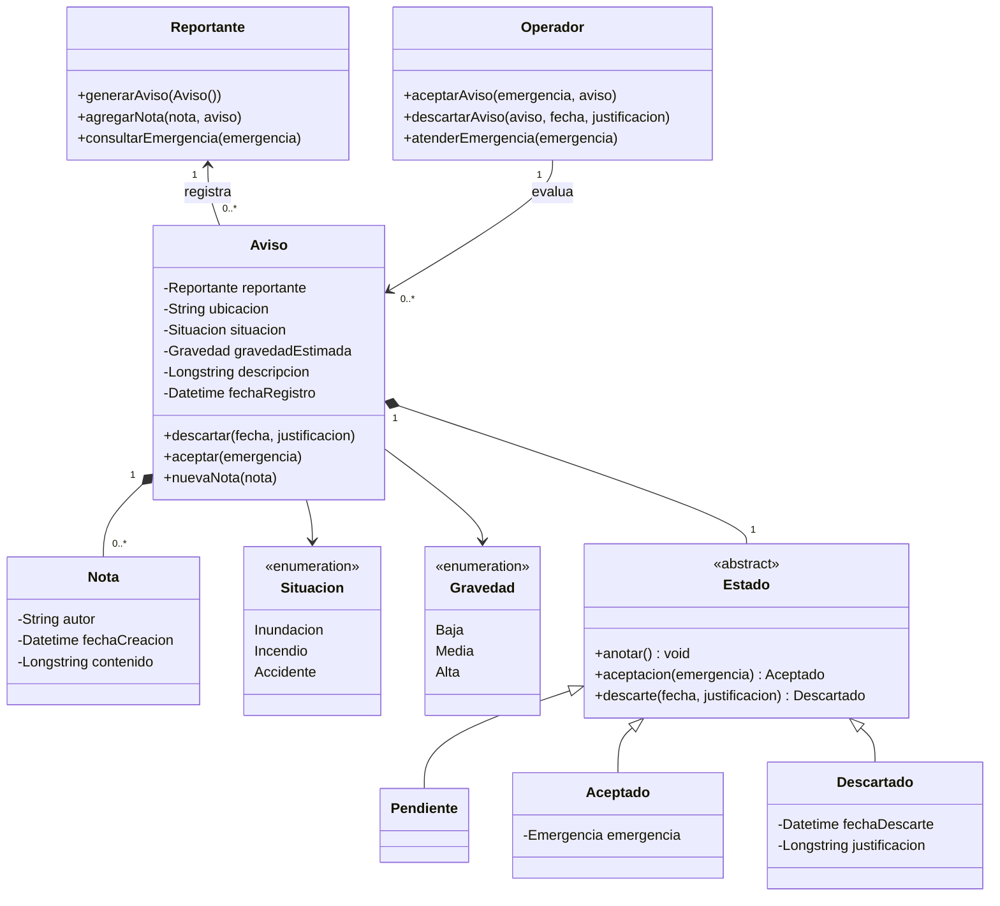
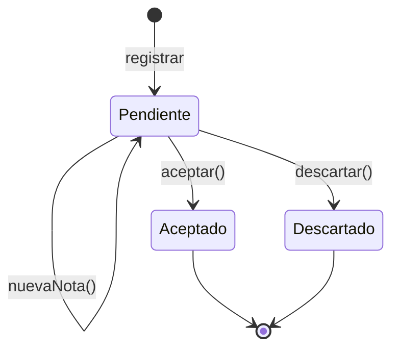

# Avance 1 — Avisos y notas

## Reglas que el código hace cumplir
 
|  #  |    Regla    |   Fuente   |
| --- | ----------- | ---------- |
| R1  | Un aviso nace pendiente, con ubicación, tipo de situación, gravedad estimada, descripción, reportante y fecha y hora de registro. | §2.1, §7.1 |
| R2  | Mientras el aviso está pendiente se le pueden agregar notas de texto. Cada nota conserva autor, fecha y hora. | §2.1 |
| R3  | Agregar una nota no cambia ningún dato original del aviso. | §2.1 |
| R4  | Descartar exige una justificación no vacía. El aviso descartado conserva la justificación y su fecha. | §2.2, §7.1 |
| R5  | Un aviso que ya no está pendiente (descartado o aceptado) rechaza nuevas notas y nuevas evaluaciones. Un segundo descarte también se rechaza. | §7.1 |
| R6  | Una operación rechazada no deja cambios: falla antes de modificar el objeto. | §9 |
- Además el tipo de situación y la gravedad son catálogos cerrados (§3 y §4).

---
## Diagrama de Clases

- En caso de tener problemas para visualizar el siguiente diagrama dirijase a `/Diagramas/UML_Clases_Avance1.png`:

`Aceptado.emergencia` y `Operador.aceptarAviso` pertenecen a una etapa posterior, únicamente se incluyeron en este avance para completar todo lo posible las clases.

---
## Diagrama de Estados de la Clase Aviso

- En caso de tener problemas para visualizar el siguiente diagrama dirijase a `/Diagramas/UML_Estados_Avance1.png`:

 
---
## Tarjetas CRC

|     Clase      | Responsabilidades                                                         |           Colaboradores |
| :------------: | ------------------------------------------------------------------------- | :---------------------: |
|   **Aviso**    | Conservar información de un aviso, cambiar de estado                      | Nota, Estado, Reportante, Operador |
|    **Nota**    | Conservar información de una nota                                         |                   Aviso |
|   **Estado**   | Permitir/bloquear agregación de notas, devolver resultado de transiciones |                   Aviso |
| **Pendiente**  | Permitir agregar notas, transicionar a aceptado o descartado              |                   Aviso |
|  **Aceptado**  | Bloquear agregar notas y transiciones, enlazar un aviso a una emergencia  |       Aviso, Emergencia |
| **Descartado** | Bloquear agregar notas y transiciones, conservar la fecha y justificación del descarte |      Aviso |
| **Reportante** | Generar avisos, agregar notas a avisos                                    |                   Aviso |
|  **Operador**  | Aceptar avisos, descartar avisos                                          |                   Aviso |

---
## Pregunta Teórica

La consigna dice que puede agregar notas su reportante
¿Quién verifica eso, el aviso o la capa que recibe al usuario autenticado?

La verificación debería realizarla la capa que recibe al usuario autenticado, no el aviso.
De otra forma el aviso debería operar con datos de sesión que le son externos y se mezclarian reglas.

----------